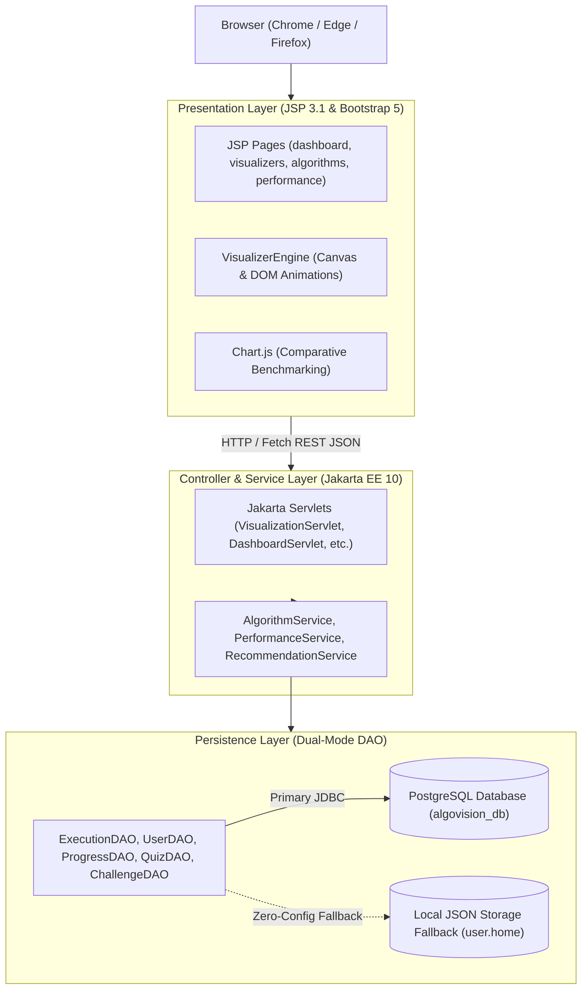

# 🚀 AlgoVision Pro
### *Interactive Data Structures & Algorithms Learning, Real-Time Visualization, and Performance Analysis Platform*


---

## 📌 Table of Contents
1. [Overview](#-overview)
2. [Key Features](#-key-features)
   - [Algorithm Visualizer](#1-algorithm-visualizer-engine)
   - [Data Structures Visualizer](#2-data-structures-visualizer)
   - [Intelligent Recommendation Engine](#3-intelligent-algorithm-recommendation-engine)
   - [Performance Benchmarking](#4-real-time-performance-benchmarking)
   - [Student Dashboard & Analytics](#5-student-dashboard--learning-analytics)
   - [Quizzes & Practice Challenges](#6-quizzes--coding-challenges)
   - [PDF Report Generation](#7-automated-pdf-report-generator)
3. [Architecture & Technology Stack](#-architecture--technology-stack)
4. [Project Directory Structure](#-project-directory-structure)
5. [Prerequisites](#-prerequisites)
6. [Installation & Setup](#-installation--setup)
   - [Importing into Eclipse IDE](#option-a-eclipse-wtp--apache-tomcat-101-recommended)
   - [Database Setup & Dual Persistence](#database-setup--zero-config-persistence)
   - [Command-Line Compilation](#option-b-command-line-compilation)
7. [Default Demo Credentials](#-default-demo-credentials)
8. [Servlet Endpoints & Route Map](#-servlet-endpoints--route-map)
9. [Future Roadmap](#-future-roadmap)
10. [License](#-license)

---

## 📖 Overview

**AlgoVision Pro** is a modern, enterprise-grade educational web platform designed to make learning Data Structures and Algorithms (DSA) intuitive, visual, and measurable. 

Rather than treating algorithms as abstract code snippets, AlgoVision Pro brings them to life through:
- **Step-by-step playback engines** with precise comparison and swap tracking
- **Graph and tree animations** depicting node traversals and path-finding state machines
- **Empirical benchmarking tools** contrasting theoretical Big-O complexities against real millisecond execution times
- **A centralized student dashboard** that dynamically tracks completed algorithms, streaks, and learning mastery

The system is built with a resilient **Dual-Mode Persistence Architecture**: it connects seamlessly to a **PostgreSQL** database, yet automatically transitions to an intelligent **JSON file-backed persistent storage layer** if the database is unavailable, allowing zero-friction setup right out of the box!

---

## ✨ Key Features

### 1. Algorithm Visualizer Engine
Provides dedicated interactive visualizer workspaces categorized into:

- **Sorting Algorithms**:
  - `Bubble Sort`, `Selection Sort`, `Insertion Sort`, `Merge Sort`, `Quick Sort`, `Heap Sort`
  - Features real-time bar height rendering, element highlight states (active comparison, pivot, swapped, sorted), adjustable animation speed, and custom comma-separated array input.
- **Searching Algorithms**:
<<<<<<< HEAD
  - `Linear Search`, `Binary Search`
  - Automatic pre-sorting for binary search, search window indicator, target value tracking, and step-by-step state logging.
- **Graph Algorithms**:
  - `Breadth-First Search (BFS)`, `Depth-First Search (DFS)`, `Dijkstra's Shortest Path`, `Kruskal's MST`
=======
  - `Linear Search`, `Binary Search`, `Jump Search`
  - Automatic pre-sorting for binary/jump searches, search window indicator, target value tracking, and step-by-step state logging.
- **Graph Algorithms**:
  - `Breadth-First Search (BFS)`, `Depth-First Search (DFS)`, `Dijkstra's Shortest Path`, `Prim's Minimum Spanning Tree (MST)`, `Kruskal's MST`
>>>>>>> fed217333f11b4d98f082fe8fde3aa9b2dbf5650
  - Dynamic HTML5 Canvas rendering nodes, directed/undirected edges, edge weights, visited node tracking, priority queues, and disjoint-set cycle detection.

### 2. Data Structures Visualizer
Interactive simulations illustrating fundamental data structure mechanics:
- **Stack**: Push, Pop, Peek, and Overflow/Underflow visual feedback.
- **Queue**: Enqueue, Dequeue, Front, and FIFO sequential shift animations.
- **Singly Linked List**: Head/Tail insertion, deletion, and pointer traversal.
- **Binary Search Tree (BST)**: Insertion, in-order / pre-order traversal, and node balancing.
- **Max Heap**: Array-to-tree mapping with automatic heapify bubble-up / bubble-down steps.

### 3. Intelligent Algorithm Recommendation Engine
An interactive advisory module (`/recommendation`) designed to guide developers to the optimal algorithm for real-world scenarios:
- **Smart Filtering**: Filter by category (`Sorting`, `Searching`, `Graph`), problem constraints, stability requirements, and memory overhead (In-Place vs Auxiliary).
- **Interactive Search**: Type any algorithm name or scenario (e.g., *"Dijkstra"*, *"Shortest Path"*, *"In-Place Sorting"*) to instantly surface matching algorithms.
- **Algorithmic Breakdown**: Displays Best, Average, and Worst-case time complexities, auxiliary space complexities, stability indicators, and direct links to **Run Visualizer** or **Download PDF Report**.

### 4. Real-Time Performance Benchmarking
The Performance Analysis module (`/performance`) benchmarks algorithms against synthetic datasets:
- **Configurable Input Types**: Random, Sorted (Best Case), and Reverse Sorted (Worst Case).
- **Scalable Array Sizes**: Benchmarks across small (50 items), medium (500 items), and large (2,000+ items) workloads.
- **Comparative Metrics**: Side-by-side graphs and tables tracking:
  - Total Wall-Clock Execution Time ($\text{ms}$)
  - Comparison Operations Count
  - Swap / Element Shift Operations Count
  - Memory Footprint Estimates

### 5. Student Dashboard & Learning Analytics
A comprehensive command center (`/dashboard`) tailored to the student's learning journey:
- **Live Metric Cards**:
  - **Algorithms Completed**: Dynamically increments every time an algorithm is visualized or executed.
  - **Problems Solved**: Tracks accepted coding challenge submissions and topic mastery.
  - **Average Quiz Score**: Real-time percentage across all completed assessment quizzes.
  - **Learning Streak**: Daily streak tracker keeping students consistent.
- **Topic Progress Breakdown**:
  - Progress bars and doughnut charts tracking completion percentages across Sorting, Searching, Graph, and Data Structures.
  - Automatic identification of **Strongest Area** and recommended **Focus Area**.
- **Recent Algorithm Visualizations Table**:
  - Chronological audit of the most recently performed algorithm runs.
  - Category badges (`bg-indigo` Sorting, `bg-info` Searching, `bg-purple` Graph).
  - One-click **`Run`** button to immediately launch and auto-play the visualizer with identical parameters.
  - Direct **`PDF`** button to download a complete execution audit report.

### 6. Quizzes & Coding Challenges
- **Quizzes (`/quiz`)**: Multiple-choice assessments covering time complexity, edge cases, and algorithm mechanics with instant grading, score logs, and answer explanations.
- **Challenges (`/challenges`)**: Practice algorithmic problems (e.g., Two Sum, Valid Parentheses, Reverse Linked List) with sample test cases, solution submission tracking, and status badges (`Accepted`, `Pending Review`).

### 7. Automated PDF Report Generator
Powered by **OpenPDF**, users can export clean, print-ready PDF reports on-demand for any algorithm:
- Generates execution logs, performance statistics, Big-O complexity tables, and timestamped audit summaries.
<<<<<<< HEAD

---

## 🏗 Architecture & Technology Stack



| Layer | Technologies Used |
|---|---|
| **Language & Runtime** | Java 21 LTS / Java 23 (Bytecode targeted to Java 21) |
=======
- 
 Technologies Used 
  
| **Language & Runtime** | Java 21 LTS / Java 23 
>>>>>>> fed217333f11b4d98f082fe8fde3aa9b2dbf5650
| **Servlet Specification** | Jakarta EE 10 (Jakarta Servlet 6.0, JSP 3.1) |
| **Application Server** | Apache Tomcat 10.1.x |
| **Front-End Framework** | Bootstrap 5.3, Bootstrap Icons, Custom Dark Theme CSS |
| **Visualization & Graphics** | HTML5 Canvas API, Vanilla ES6 JavaScript, Chart.js |
| **Primary Database** | PostgreSQL 14+ via PostgreSQL JDBC Driver 42.7.2 |
| **Fallback Persistence** | Google Gson 2.10.1 (Atomic File-backed JSON Storage) |
| **PDF Generation** | OpenPDF 1.3.30 |
| **Password Security** | SHA-256 Hashing with Hex Encoding (`PasswordUtil`) |

---

## 📁 Project Directory Structure

```text
AlgoVision/
├── src/
│   └── com/algovision/
│       ├── algorithm/          # Core sorting, searching, and graph algorithm implementations
│       │   ├── BubbleSort.java, QuickSort.java, MergeSort.java, HeapSort.java, ...
<<<<<<< HEAD
│       │   ├── LinearSearch.java, BinarySearch.java
│       │   ├── BFS.java, DFS.java, Dijkstra.java, Kruskal.java
=======
│       │   ├── LinearSearch.java, BinarySearch.java, JumpSearch.java
│       │   ├── BFS.java, DFS.java, Dijkstra.java, Prim.java, Kruskal.java
>>>>>>> fed217333f11b4d98f082fe8fde3aa9b2dbf5650
│       │   └── AlgorithmStep.java, GraphStep.java
│       ├── controller/         # Jakarta HTTP Servlets
│       │   ├── DashboardServlet.java, VisualizationServlet.java, AlgorithmServlet.java
│       │   ├── PerformanceServlet.java, RecommendationServlet.java, ReportServlet.java
│       │   ├── QuizServlet.java, ChallengeServlet.java, DataStructureServlet.java
│       │   └── LoginServlet.java, RegisterServlet.java, LogoutServlet.java, AdminServlet.java
│       ├── dao/                # Data Access Objects with DB + JSON Dual Persistence
│       │   ├── ExecutionDAO.java, UserDAO.java, ProgressDAO.java
│       │   ├── AlgorithmDAO.java, QuizDAO.java, ChallengeDAO.java
│       ├── datastructure/      # Data structure state machines (Stack, Queue, BST, Heap, etc.)
│       ├── model/              # Domain models (User, Execution, Algorithm, QuizResult, etc.)
│       ├── service/            # Business logic and benchmark calculation engines
│       └── util/               # DBConnection, PasswordUtil, ValidationUtil, PDFReportGenerator
├── WebContent/
│   ├── css/
│   │   └── style.css           # Premium dark theme styling and custom accents
│   ├── js/
│   │   ├── visualization.js    # VisualizerEngine core DOM & bar animation controller
│   │   ├── sorting.js          # Sorting & searching form handlers and step dispatchers
│   │   └── datastructures.js   # Interactive canvas controller for stacks, queues, trees
│   ├── algorithms/             # algorithms.jsp, algorithmDetail.jsp
│   ├── challenges/             # challenges.jsp
│   ├── performance/            # performance.jsp
│   ├── progress/               # progress.jsp
│   ├── quiz/                   # quiz.jsp, result.jsp
│   ├── recommendation/         # recommendation.jsp
│   ├── reports/                # report.jsp
│   ├── visualization/          # sortingVisualizer.jsp, searchingVisualizer.jsp, graphVisualizer.jsp, dsVisualizer.jsp
│   ├── index.jsp               # Public landing page with showcase carousel
│   ├── dashboard.jsp           # Main student analytics dashboard
│   ├── login.jsp, register.jsp # Authentication pages
│   └── WEB-INF/
│       ├── web.xml             # Servlet 6.0 routing & configuration
│       ├── classes/            # Compiled class binaries
│       └── lib/                # Embedded dependencies (gson, openpdf, postgresql, jakarta-apis)
└── README.md
```

---

## ⚙ Prerequisites

Before running the application, ensure the following are installed:
1. **Java Development Kit (JDK)**: Version 21 LTS or later.
2. **Apache Tomcat**: Version **10.1.x** (Note: Tomcat 9 or earlier will *not* work because AlgoVision Pro utilizes `jakarta.servlet` packages).
3. **Eclipse IDE for Enterprise Java and Web Developers** (Recommended) or IntelliJ IDEA Ultimate.
4. **PostgreSQL** (Optional): Version 14 or higher if running with database storage.

---

## 🚀 Installation & Setup

### Option A: Eclipse WTP & Apache Tomcat 10.1 (Recommended)

1. **Clone or Download the Project**:
   ```bash
   git clone https://github.com/your-username/AlgoVision.git
   ```
2. **Open Eclipse**:
   - Select **File > Open Projects from File System...**
   - Choose the root directory of `AlgoVision`.
3. **Configure the Server**:
   - Open the **Servers** tab in Eclipse (`Window > Show View > Servers`).
   - Click **Add New Server**, select **Apache > Tomcat v10.1 Server**, and point it to your local Tomcat 10.1 installation directory.
4. **Add AlgoVision to Tomcat**:
   - Right-click the newly configured Tomcat server > **Add and Remove...**
   - Move **AlgoVision** from *Available* to *Configured*.
5. **Start Server**:
   - Right-click the server > **Start**.
   - Open your browser and navigate to:
     ```text
     http://localhost:8080/AlgoVision/
     ```

---

### Database Setup & Zero-Config Persistence

AlgoVision Pro supports **two execution modes**:

#### Mode 1: Zero-Config JSON Persistence (Default / Out-of-the-Box)
If PostgreSQL is not running or credentials fail, AlgoVision Pro **automatically switches to its built-in JSON file storage**. All metrics, executions, user accounts, and quiz results are stored safely in:
```text
C:\Users\<YourUsername>\algovision_executions.json
C:\Users\<YourUsername>\algovision_progress.json
C:\Users\<YourUsername>\algovision_users.json
```
No database setup or installation is required to use all features of the application!

#### Mode 2: PostgreSQL Database (Production Mode)
To use a live PostgreSQL instance:
1. Create a database named `algovision_db`:
   ```sql
   CREATE DATABASE algovision_db;
   ```
2. Check database credentials in `src/com/algovision/util/DBConnection.java`:
   ```java
   private static final String DB_URL = "jdbc:postgresql://localhost:5432/algovision_db";
   private static final String DB_USER = "postgres";
   private static final String DB_PASSWORD = "your_postgres_password";
   ```
3. On application startup, AlgoVision will automatically create all tables (`users`, `algorithms`, `algorithm_executions`, `user_progress`, `quizzes`, `quiz_questions`, `challenges`, `user_submissions`) and seed default data.

---

### Option B: Command-Line Compilation

To compile all Java source files directly into `WebContent/WEB-INF/classes` targeting Java 21 bytecode:

**On Windows (PowerShell):**
```powershell
$files = (Get-ChildItem -Recurse -Filter *.java src | ForEach-Object { $_.FullName })
javac --release 21 -cp "WebContent/WEB-INF/lib/*;WebContent/WEB-INF/classes" -d WebContent/WEB-INF/classes $files
```

---

## 🔑 Default Demo Credentials

You can test the application using the following pre-configured user accounts:

| Role | Email | Password | Access Level |
|---|---|---|---|
| **Student (Default)** | `student@algovision.com` | `student123` | Full Access (Visualizers, Quizzes, Challenges, Dashboard) |
<<<<<<< HEAD
| **Admin** | `admin@algovision.com` | `admin123` | Administrator Portal (`/admin`), Metrics, System Management |

